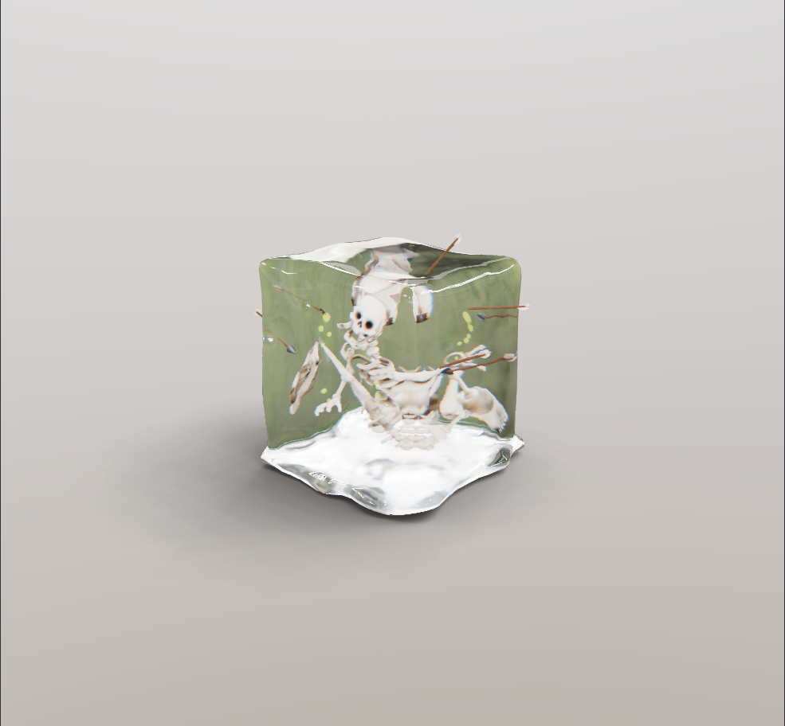
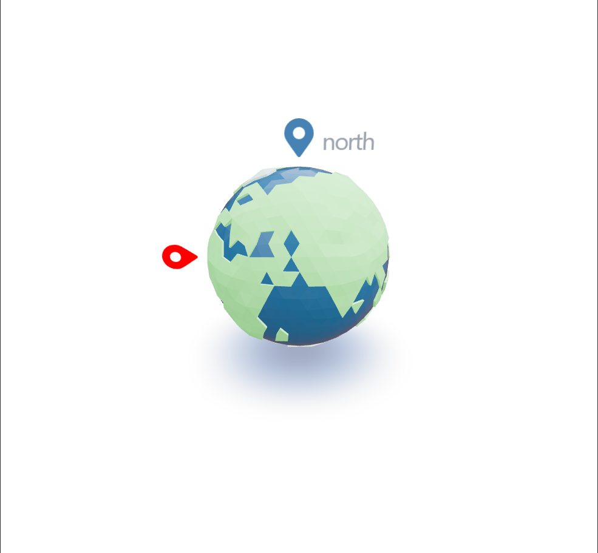

# three-react-examples

A small gallery of 3D demos built with **React**, **Three.js** and **React Three Fiber** (with Drei helpers), bundled with **Vite**. Each example lives in its own folder and is routed from `App.jsx`.

|                   Gelatinous Cube                   |                 Earth Marker                  |
| :-------------------------------------------------: | :-------------------------------------------: |
|  |  |

## Examples

### Gelatinous Cube

A translucent, jelly-like cube with a skeleton trapped inside.

- Glassy look using Drei's `MeshTransmissionMaterial` on the cube model
- Skeleton model placed inside the cube
- HDR environment (`dancing_hall.hdr`) for reflections and lighting
- Soft shadows and orbit camera controls

This is the default route, so opening the app redirects here.

### Earth Marker

A low-poly globe with floating map-pin labels.

- Earth model loaded from a glTF file
- Pins placed around the globe, rendered as HTML with Drei's `Html` component
- Markers fade in and out based on camera distance and whether the globe occludes them
- City HDR environment, ambient light, contact shadows and orbit controls

## What I can learn from it

- Loading `.gltf` / `.glb` models
- Environment lighting and shadows
- Orbit camera interaction
- Mixing 3D objects with HTML overlays
- Working with transmissive (translucent) materials

## Getting started

Requires Node.js 18 or newer.

```bash
# install dependencies
npm install

# start the dev server
npm run dev

# build for production
npm run build
```

Then open the local URL Vite prints in the terminal (usually `http://localhost:5173`).

## Project structure

```
three-react-examples/
├── public/
│   ├── models/              # earth.gltf, cubes.glb, skeleton.glb
│   └── environments/        # dancing_hall.hdr
├── src/
│   ├── assets/
│   ├── examples/
│   │   ├── EarthMarker/
│   │   │   ├── components/
│   │   │   │   ├── marker.jsx   # HTML pin labels with fade/occlusion
│   │   │   │   ├── model.jsx    # loads the globe and places markers
│   │   │   │   └── scene.jsx    # lights, environment, shadows, controls
│   │   │   └── earth-marker.jsx # canvas entry for this example
│   │   └── GelatinousCube/
│   │       ├── components/
│   │       │   ├── ooze-cube.jsx # cube with transmission material
│   │       │   ├── scene.jsx     # lights, environment, shadows, controls
│   │       │   └── skele.jsx     # skeleton inside the cube
│   │       └── gelatinous-cube.jsx # canvas entry for this example
│   ├── App.jsx              # routes between examples
│   ├── example.jsx
│   ├── main.jsx
│   ├── App.css
│   └── index.css
├── index.html
├── vite.config.js
└── package.json
```

## Adding your own example

1. Create a folder in `src/examples/`, e.g. `MyScene/`.
2. Add a `my-scene.jsx` that renders a `<Canvas>` and a `components/scene.jsx` for lights, environment and controls.
3. Put any models in `public/models/` and load them with Drei's `useGLTF`.
4. Register a new route for it in `src/App.jsx`.

## Tech stack

- [React](https://react.dev)
- [Three.js](https://threejs.org)
- [React Three Fiber](https://docs.pmnd.rs/react-three-fiber)
- [Drei](https://github.com/pmndrs/drei)
- [Vite](https://vitejs.dev)
